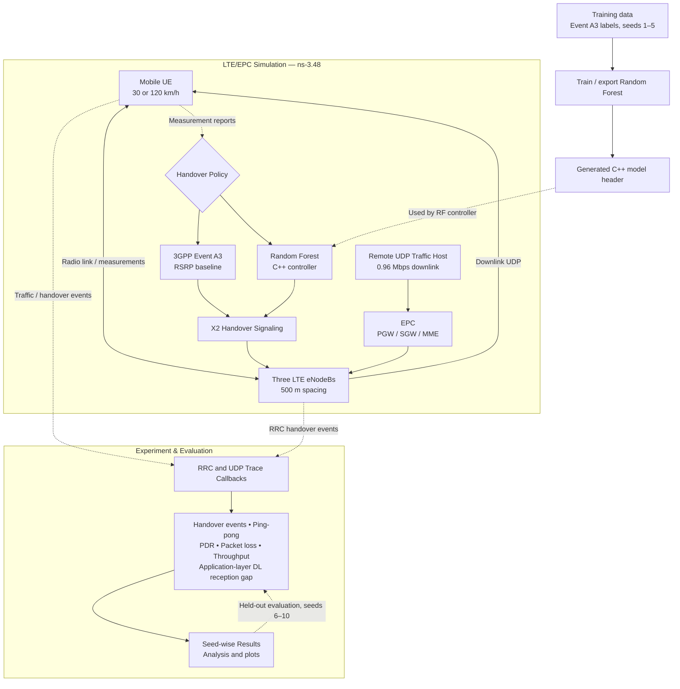

# LostPacket: Simulation-Based Handover Decision Evaluation for High-Mobility Users

**Team ID**: A3-PS016-TC243  
**Problem Statement**: PS-016 — Simulation-Based Handover Decision Evaluation for High-Mobility Users  
**Platform**: ns-3.48 (Discrete-Event Network Simulator, LTE/EPC Module)  

---

## Project Links

- **GitHub Repository:** [LostPacket – A3-PS016-TC243](https://github.com/aiori-hackathon/A3-PS016-TC243)
- **Hackathon Presentation:** [View Presentation](LostPacket-AIORI3-Presentation_A3-PS016-TC243.pdf)
- **Technical Report:** [View Technical Report](report/technical_report.pdf)
- **Proposed Structure:** [View Proposed Structure](Proposed-structure-hackathon.pdf)

### Videos

- **Team Introduction Video:** [Watch on YouTube](https://www.youtube.com/watch?v=6Az3SuHVH18)
- **Project Demonstration Video:** [Watch on YouTube](https://www.youtube.com/watch?v=Bgdr0fauql0)

### Run the Demonstration

From the repository root, run:

```bash
./demo.sh
```

---

## 1. Project Overview

LostPacket is an **ns-3.48 LTE/EPC simulation and evaluation project** for studying handover decisions in a high-mobility scenario. It compares the built-in 3GPP Event A3 Reference Signal Received Power (RSRP) handover policy with a supervised Random Forest controller implemented in C++.

The evaluation examines handover activity and application-layer traffic metrics under two simulated UE speeds: 30 km/h and 120 km/h. The Random Forest is trained to imitate Event A3 decisions; it is **not** trained against an independently optimized handover policy.

**Scope:** All experiments use ns-3.48 LTE/EPC modules. This project does not implement or evaluate a 5G/5G-LENA system.

## 2. System Architecture

The diagram summarizes the simulation, handover-control, and evaluation flow.



**Reading the diagram:** The same simulated LTE/EPC scenario is evaluated with either the A3 baseline or the Random Forest controller. The forest is trained on A3-generated labels. RRC and application UDP traces feed the reported metrics. The reception-gap metric is an application-layer proxy, not a direct physical-layer interruption measurement.

---

## 3. Problem Statement Context

In cellular communications, handovers transfer an ongoing data session from a source base station (eNodeB) to a target eNodeB as a User Equipment (UE) moves through space. Conventional handover algorithms depend on the 3GPP Event A3 condition:

`RSRP_target > RSRP_serving + Hysteresis` continuously for the configured `TimeToTrigger` duration.

In high-mobility scenarios (e.g., highway vehicular transit at 120 km/h), rapid path loss changes, small-scale fading, and steep signal attenuation gradients create acute operational challenges:
1. **Too-Late Handover**: Prolonged Time-to-Trigger or excessive hysteresis delays triggering until radio link failure occurs, causing severe packet loss and application blackout.
2. **Too-Early / Ping-Pong Handover**: Insufficient hysteresis causes premature handover or rapid oscillation between base stations (A → B → A), inducing control-plane signaling storms and recurring user-plane interruption.

This project delivers a simulation-based evaluation framework to quantify these trade-offs, collect genuine training data across multi-seed runs, train a supervised Random Forest policy via imitation learning, and evaluate performance on strictly held-out simulation seeds.

---

## 4. Network Architecture and Radio Model

### 4.1 Network Topology
- **Cells**: 3 linear LTE macro eNodeBs positioned along a transit corridor:
  - eNodeB 1: (0 m, 0 m, 0 m)
  - eNodeB 2: (500 m, 0 m, 0 m)
  - eNodeB 3: (1000 m, 0 m, 0 m)
- **User Equipment (UE)**: Single vehicular UE starting at coordinate (-100 m, 0 m, 0 m) and moving eastward along the x-axis.
- **Mobility Model**: Constant velocity mobility (`ns3::ConstantVelocityMobilityModel`):
  - Speed Class 1: 30 km/h (approximately 8.333 m/s) (Duration: 240 s)
  - Speed Class 2: 120 km/h (approximately 33.333 m/s) (Duration: 60 s)
  - Active Service Corridor: x = -100 m to x = 1200 m (1300 m span; transit time: 156 s at 30 km/h, 39 s at 120 km/h).
  - Total Trajectory: 2000 m (x = -100 m to x = +1900 m) under a 1.5× observation safety factor, providing an extended post-handover stability monitoring window (84 s at 30 km/h; 21 s at 120 km/h) past nominal exit to verify zero late ping-pongs or link drops.
- **X2 Interface**: Full-mesh point-to-point X2 inter-eNodeB interfaces (`lteHelper->AddX2Interface(enbNodes)`) for direct handover preparation and execution signaling.

### 4.2 Radio and Physical Layer Parameters
All radio attributes are verified and explicitly configured in `scratch/lostpacket-lte-handover.cc`:
- **Propagation Loss Model**: `ns3::FriisPropagationLossModel` (free-space path loss with isotropic antennas).
- **Spectrum Channel**: `ns3::MultiModelSpectrumChannel`.
- **eNodeB Transmission Power**: 46.0 dBm (40 W per component carrier).
- **Antenna Model**: `ns3::IsotropicAntennaModel` (0 dBi gain).
- **MAC Scheduler**: Round-Robin MAC scheduler (`ns3::RrFfMacScheduler`).
- **Carrier Configuration**: EARFCN 100 (DL 2120 MHz), EARFCN 19100 (UL 1930 MHz), 25 Resource Blocks (5 MHz bandwidth).

### 4.3 Traffic and End-to-End Core Network
- **Evolved Packet Core (EPC)**: `PointToPointEpcHelper` instantiating PGW, SGW, and MME entities.
- **Remote Internet Host**: Connected to PGW via a 100 Gbps, 10 ms delay Point-to-Point link.
- **Downlink User-Plane Stream**: UDP traffic generated via `ns3::UdpClient` to `ns3::PacketSink` on port 9000:
  - Packet Size: 1200 bytes
  - Interval: 10 ms
  - Offered Load: 0.96 Mbps continuous downlink stream

---

## 5. Handover Decision Policies

### 5.1 Baseline: 3GPP Event A3 RSRP
The reference policy utilizes the standard ns-3 `ns3::A3RsrpHandoverAlgorithm`:
- **Hysteresis**: 3.0 dB
- **Time-to-Trigger (TTT)**: 256 ms
- **Report Interval**: 1024 ms

### 5.2 Supervised Learning: Random Forest Controller
- **Algorithm Class**: `ns3::RfHandoverAlgorithm` extending `ns3::LteHandoverAlgorithm`.
- **Model Architecture**: Ensemble of 30 decision trees, maximum depth 5, minimum split 4, balanced class weighting.
- **Parity Engine**: The trained forest is exported to `scratch/rf-model-generated.h` and executed via an in-memory tree traversal engine. Max probability difference compared to scikit-learn is verified at 0 (reported maximum probability difference).
- **Pending Handover Guard**: Maintains a per-RNTI timestamp record. Re-triggering is suppressed within a 2.0-second guard interval to prevent conflicting commands.

### 5.3 Feature Space and Provenance
At each measurement epoch, an 8-dimensional feature vector is evaluated:
1. `serving_rsrp_dbm`: RSRP of current serving eNodeB.
2. `target_rsrp_dbm`: RSRP of candidate target eNodeB.
3. `delta_rsrp_db`: target RSRP minus serving RSRP.
4. `serving_rsrq_db`: RSRQ of current serving eNodeB.
5. `target_rsrq_db`: RSRQ of candidate target eNodeB.
6. `delta_rsrq_db`: target RSRQ minus serving RSRQ.
7. `num_neighbours`: Count of visible neighbor cells.
8. `speed_kmh`: Velocity of the UE (30 or 120 km/h).

*Imitation Learning Note*: Training labels originate from Event A3 decisions across seeds 1–5 (1,685 genuine samples; 1,665 hold, 20 handover). High accuracy reflects faithful behavioral capture and decision boundary imitation rather than an inherent claim of algorithmic superiority over A3.

---

## 6. Evaluation Methodology and Experimental Results

### 6.1 Seed Isolation
- **Training Seeds**: 1, 2, 3, 4, 5 (Speeds: 30 km/h, 120 km/h).
- **Held-Out Evaluation Seeds**: 6, 7, 8, 9, 10 (Strictly isolated; zero train/test leakage).

### 6.2 Measured Performance Metrics
1. **Handover Attempts, Successes, Failures**: Traced directly via eNodeB RRC (`HandoverStart`, `HandoverEndOk`, and four failure callbacks: `NoPreamble`, `MaxRach`, `Leaving`, `Joining`) and UE RRC (`HandoverEndError`).
2. **Ping-Pong Events**: Documented 5.0-second sliding window definition (A → B → A).
3. **Packet Transmission and Delivery**: Traced at the application layer via `UdpClient::TxWithAddresses` and `PacketSink::Rx` callbacks (exact packet counting without byte-division approximations).
4. **Throughput**: Calculated per second and as an aggregate simulation mean.
5. **Handover-Associated DL Packet Reception Gap**: Interval between the last received packet prior to `HandoverStart` and the first received packet following `HandoverEndOk` (operational proxy; not claimed to be physical-layer user-plane interruption).

### 6.3 Held-Out Results Table (Seeds 6-10)

| Policy | Speed (km/h) | Runs | HO Attempts | HO Successes | HO Failures | Ping-Pong | PDR (%) | Packet Loss | Throughput (Mbps) | Mean DL Gap (s) |
|---|---|---|---|---|---|---|---|---|---|---|
| **A3** | 30 | 5 | 2.00 +/- 0.00 | 2.00 +/- 0.00 | 0.00 +/- 0.00 | 0.00 +/- 0.00 | 99.938 +/- 0.024 | 14.8 +/- 5.8 | 0.9590 +/- 0.0002 | 0.0340 +/- 0.0338 |
| **A3** | 120 | 5 | 2.00 +/- 0.00 | 2.00 +/- 0.00 | 0.00 +/- 0.00 | 0.00 +/- 0.00 | 99.613 +/- 0.122 | 23.2 +/- 7.3 | 0.9547 +/- 0.0012 | 0.0600 +/- 0.0156 |
| **RF** | 30 | 5 | 2.00 +/- 0.00 | 2.00 +/- 0.00 | 0.00 +/- 0.00 | 0.00 +/- 0.00 | 99.945 +/- 0.023 | 13.2 +/- 5.5 | 0.9591 +/- 0.0002 | 0.0310 +/- 0.0305 |
| **RF** | 120 | 5 | 2.00 +/- 0.00 | 2.00 +/- 0.00 | 0.00 +/- 0.00 | 0.00 +/- 0.00 | 99.456 +/- 0.082 | 32.6 +/- 4.9 | 0.9532 +/- 0.0008 | 0.0580 +/- 0.0175 |

**How to read these results:** Values are reported as mean +/- standard deviation across five held-out seeds per policy/speed combination. Results are mixed: RF has slightly higher PDR at 30 km/h, while A3 has higher PDR and lower packet loss at 120 km/h. These results do not establish general Random Forest superiority.

---

## 7. Repository Structure

```text
lostpacket/
├── demo.sh                                # Root one-command demonstration runner
├── README.md                              # Main project documentation (this file)
├── docs/
│   └── demo_runbook.md                    # Detailed runbook and video presentation script
├── report/
│   ├── pseudocode.md                      # Formal pseudocode for all algorithms
│   ├── technical_report.md                # Comprehensive technical report (Markdown)
│   ├── technical_report.pdf               # Compiled technical report (PDF)
│   └── technical_report.html              # HTML rendering of the report
├── ns-3.48/
│   ├── scratch/
│   │   ├── lostpacket-lte-handover.cc     # Main simulation scenario
│   │   ├── rf-handover-algorithm.h        # C++ Random Forest handover algorithm
│   │   └── rf-model-generated.h           # Compiled C++ Random Forest tree ensemble
│   ├── scripts/
│   │   ├── collect_training_data.sh       # Multi-seed training dataset generator
│   │   ├── train_rf.py                    # Scikit-learn training & C++ export pipeline
│   │   ├── run_evaluation.sh              # Held-out 20-run evaluation matrix
│   │   ├── analyze_results.py             # Statistical analysis and plot generator
│   │   ├── generate_pdf_report.py         # PDF report compilation tool
│   │   └── demo.sh                        # Demonstration execution script
│   ├── model/
│   │   └── rf_model.json                  # Serialized Random Forest model (JSON)
│   └── results/
│       ├── train/                         # Training data and reports (Seeds 1-5)
│       ├── eval/                          # Held-out evaluation metrics (Seeds 6-10)
│       ├── demo/                          # Demonstration run outputs
│       └── plots/                         # Generated high-resolution figures
```

---

## 8. Execution and Reproduction Instructions

### 7.1 Prerequisites
- Linux OS (Ubuntu 22.04 / 24.04 LTS or compatible).
- GCC/G++ supporting C++17 or C++20.
- CMake (>= 3.16) and Ninja build system.
- Python 3.12 with `scikit-learn`, `numpy`, `pandas`, `matplotlib`.

### 7.2 Building the Simulator
```bash
cd ns-3.48
./ns3 build
```

### 7.3 Running the Live Demonstration
From the project root:
```bash
./demo.sh
```

### 7.4 Reproducing Full Training and Evaluation Pipelines
```bash
cd ns-3.48

# 1. Collect Training Data across Seeds 1-5
./scripts/collect_training_data.sh

# 2. Train Random Forest, Verify Inference Parity, and Export Model
python3 scripts/train_rf.py

# 3. Rebuild Simulator with Compiled Random Forest Header
./ns3 build

# 4. Execute Held-Out Evaluation across Seeds 6-10
./scripts/run_evaluation.sh

# 5. Generate Statistical Summary and Comparison Figures
python3 scripts/analyze_results.py

# 6. Recompile PDF Technical Report
python3 scripts/generate_pdf_report.py
```

---

## 9. Limitations

1. **Packet Reception Gap Proxy**: The measured interruption metric reflects application-layer UDP packet reception gaps. Hardware user-plane interruption requires physical layer or PDCP buffer timestamping.
2. **Imitation Learning Baseline**: The Random Forest was trained on decisions from Event A3. It captures and replicates the A3 operational boundary rather than an unconstrained optimal policy.
3. **Linear Trajectory**: The scenario assumes a constant-velocity highway transit corridor; multi-directional urban street grids with shadowing are left for future research.

---

## 10. Team Information & Attribution

- **Project**: LostPacket
- **Team ID**: A3-PS016-TC243
- **Problem Statement**: PS-016
- **Lead Contributor / Workspace Owner**: arjya (`/home/arjya`)

